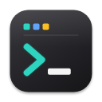
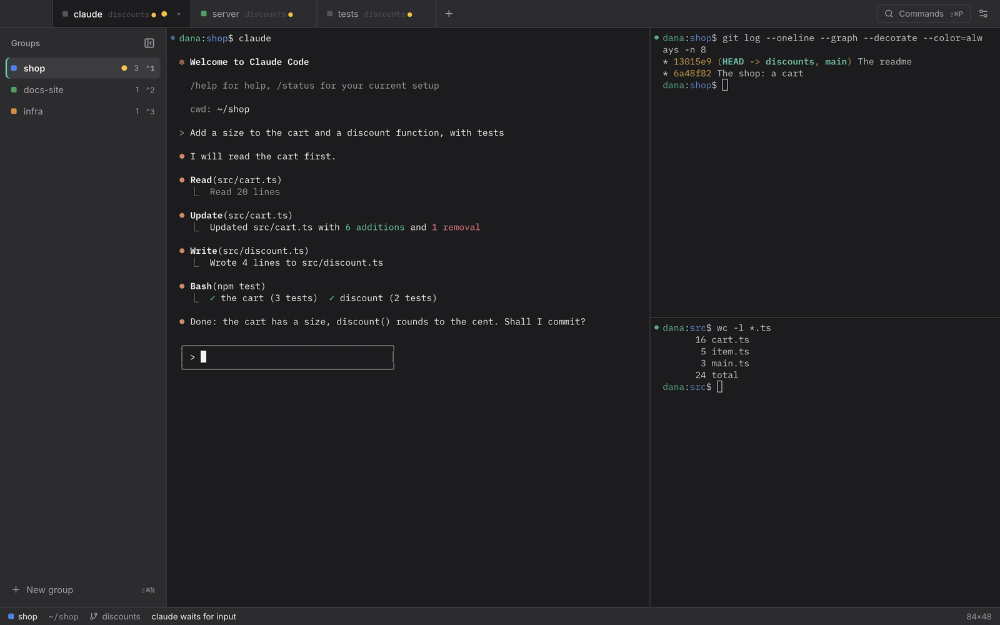
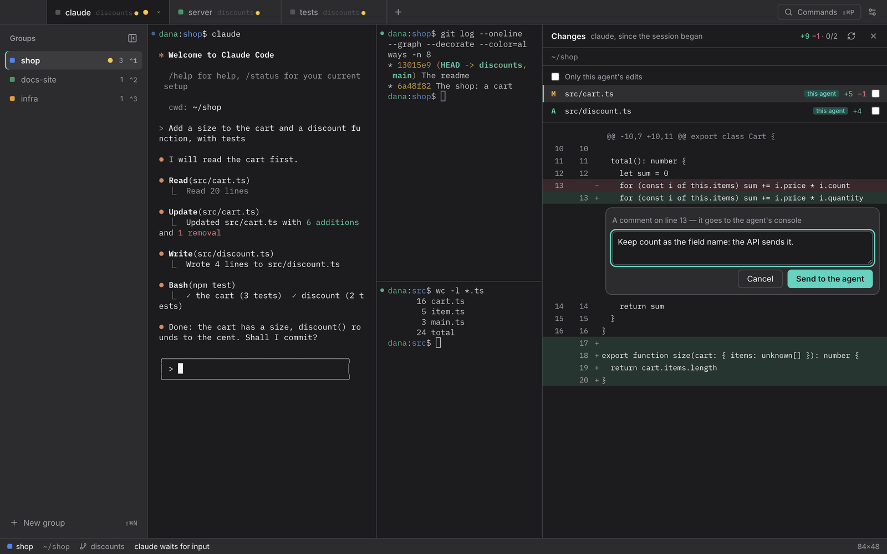
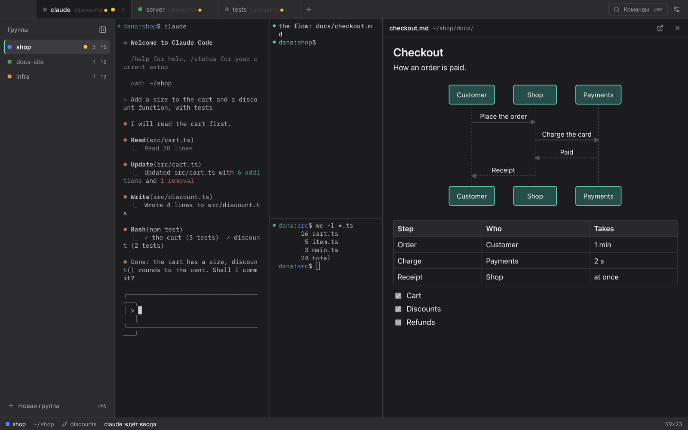
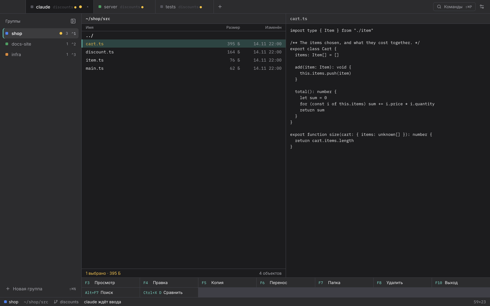
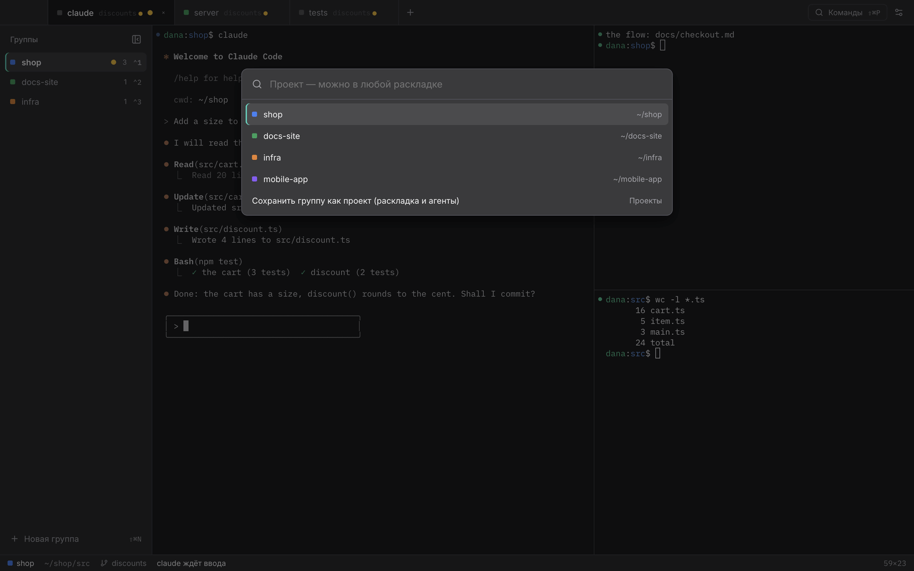
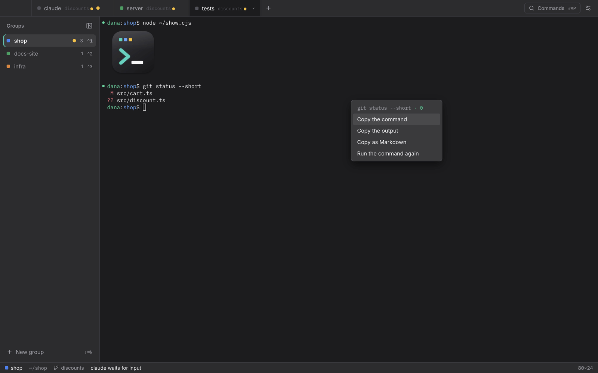
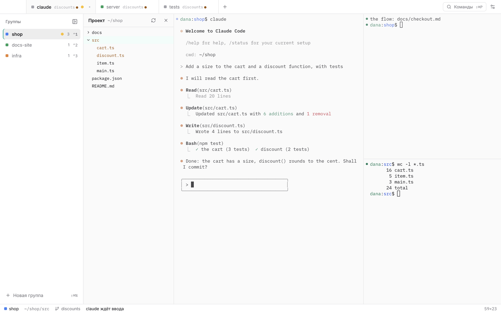

# shell

[](https://github.com/dskripchenko/shell/actions/workflows/tests.yml)
[](https://github.com/dskripchenko/shell/releases/latest)
[](https://github.com/dskripchenko/shell/blob/main/LICENSE)

A terminal for macOS, Windows and Linux, made to replace the system one:
groups of tabs, tabs named and coloured, panes split every way, every action
on keys of your own — and, next, AI agents in their panes, files the Midnight
Commander way, documents with live diagrams. Portable and offline: no
installer, no account, no telemetry.

> Status: **0.9.** Stage 1 — groups, tabs, splits, a palette, keys of your own
> (on any keyboard layout), `config.toml`, profiles, imported themes, a
> drop-down window, the session and each pane's output back after a restart,
> updates. Stage 2 — shell integration in zsh, bash and PowerShell; AI
> agents in panes shown working, waiting for you or done (with `shell-notify`
> and Claude Code's hooks); an agent's changes with their diffs; file panels as
> in Midnight Commander (Ctrl+O); a viewer of markdown with live diagrams; SSH
> hosts and their files over sftp; work handed to
> [folio](https://github.com/dskripchenko/folio) when it is there. Stage 3 —
> projects (a group's layout and agents saved, a switcher), git on the tabs
> and worktrees in groups of their own, folio both ways (documents edited
> there, a journal of agents' edits, console colours, projects), settings
> with fields, Secure Keyboard Entry, the kitty keyboard protocol. Then —
> input to every pane at once, triggers, a prompt library, commands as
> blocks, pictures (sixel, kitty), archives as folders, finding and comparing
> files, the project's tree, HTML and PDF previews; the interface in four
> languages. The plan is in
> [FEATURES.md](FEATURES.md) (in Russian).

Documentation: [English](docs/en/) · [Русский](docs/ru/) · [Deutsch](docs/de/) ·
[中文](docs/zh/)

## A look

**An agent at work.** Claude Code in one pane waits for an answer — its tab and
group say so — beside git's history and the project's files; each tab shows its
branch.



**What the agent changed.** The files since it started, whose edit each one is,
a diff, and a comment on a line that goes into the agent's pane.



**Documents beside the panes.** A path in the output opens in the viewer:
Markdown with a live diagram, a table, a task list.



**Files the Midnight Commander way.** Two panels over the terminal (Ctrl+O), a
quick view, archives as folders, SSH hosts over sftp.



**Projects.** A group's layout and agents saved, opened again from the
switcher; folio's projects listed too.



**Pictures and blocks.** sixel and kitty pictures in the output; a command's
menu — copy its output, run it again.



**Light, with the project's tree.**



The interface speaks English, Russian, German and Chinese — the system's
language by default, any of them in the settings.

## Download

From the [latest release](https://github.com/dskripchenko/shell/releases/latest):

| System | Archive | How to run |
|---|---|---|
| macOS, Apple Silicon | `shell-<version>-mac-arm64.zip` | unpack into a folder of its own, open `shell.app` |
| macOS, Intel | `shell-<version>-mac-x64.zip` | the same |
| Windows x64 | `shell-<version>-win-x64.zip` | unpack into a folder you can write to, run `shell.exe` |
| Linux x64 | `shell-<version>-linux-x64.AppImage` | `chmod +x` it and run it |

Settings, themes and the last session live in `shell-data/` beside the program;
deleting that folder removes shell completely. Each archive has a `.sha256`
beside it; its provenance: `gh attestation verify <archive> --repo dskripchenko/shell`.

**No publisher's signature.** macOS says it cannot check the developer the first
time: open it once, then System Settings → Privacy & Security → Open Anyway — or
`xattr -dr com.apple.quarantine shell.app`. Windows SmartScreen: More info → Run
anyway. Linux: an AppImage needs FUSE 2 (`libfuse2`), or run it with
`--appimage-extract-and-run`.

## Settings

Cmd/Ctrl+, opens the settings; everything is kept in `shell-data/config.toml`,
written with comments at the first start and read again whenever it is saved.
The [guide](docs/en/guide.md) has all of it, and the keys. Profiles say how to start a
shell; give one to a group (double-click the group) or open it from the palette:

```toml
[profiles.python]
program = "/bin/zsh"
args = ["-l"]
env = { VIRTUAL_ENV_DISABLE_PROMPT = "1" }
cwd = "~/projects"
theme = "UID Light"

[keys]
"cmd+k" = "palette.open"
"ctrl+a>c" = "tab.new"
```

folio, when found by itself (running, in PATH, /Applications, ~/Applications
or beside shell), opens files at their line, reviews an agent's changes and
takes a folder as a project; `[folio] path` names it otherwise.

Themes: put `.itermcolors`, Ghostty themes, Windows Terminal `.json` or base16
`.yaml` files in `shell-data/themes/` and name one in `[theme]`.

## Development

```sh
pnpm install
pnpm start          # build and run
pnpm test           # unit tests
pnpm test:e2e       # build, start the app and drive it
pnpm dist           # portable archives into release/
pnpm readme:shots   # the screenshots in docs/images (ImageMagick)
node scripts/icons.mjs   # the icons from build/icons/shell.svg (on a Mac)
```

## License

MIT — see [LICENSE](LICENSE).
