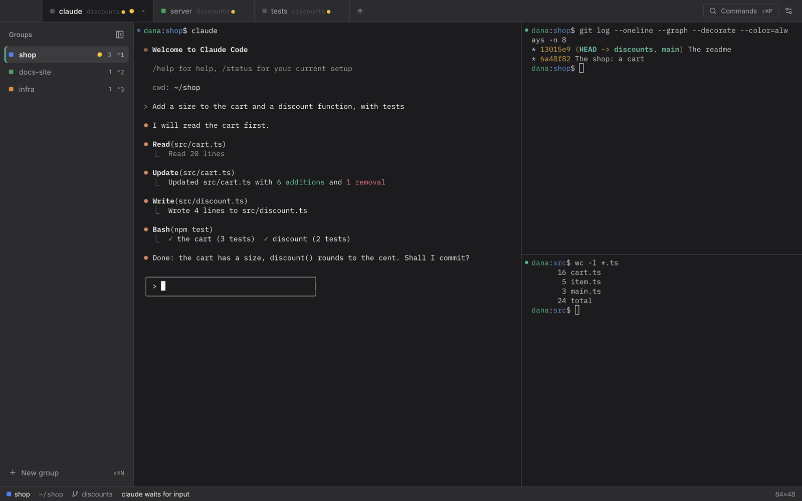

# shell

Ein Terminal für macOS, Windows und Linux, das das System-Terminal ersetzt —
und für die Arbeit neben KI-Agenten im Terminal: Claude Code, Codex, Grok und
andere. Gruppen von Tabs und geteilte Bereiche, Agenten, denen man ansieht, ob
sie arbeiten oder auf Sie warten, ihre Änderungen mit Diffs, Dateien wie im
Midnight Commander, Dokumente mit lebenden Diagrammen, SSH-Hosts. Portabel und
offline: kein Installer, kein Konto, keine Telemetrie.

> Stand: **0.9** — das Archiv für Ihr System finden Sie im [neuesten Release](https://github.com/dskripchenko/shell/releases/latest).

- [Anleitung](guide.md) — was es kann und wie: Gruppen, Agenten, Dateien,
  Betrachter, Projekte, Einstellungen, Tasten
- [Entwicklung](development.md) — bauen, starten, testen

## Neben dem System

- Die Oberfläche auf Deutsch, Englisch, Russisch oder Chinesisch —
  standardmäßig in der Sprache des Systems.
- Kein Installer, keine Administratorrechte: ein zip unter Windows und macOS,
  ein AppImage unter Linux.
- Einstellungen, Themes, die letzte Sitzung und Prompts liegen in
  `shell-data/` neben dem Programm; wer den Ordner löscht, hat shell vollständig
  entfernt.
- Ins Netz nur auf Ihren Wunsch: Updates werden einmal am Tag gesucht
  (abschaltbar), SSH ist Ihr eigenes OpenSSH.
- Das Terminal ruft selbst keine KI auf: Agenten sind Ihre
  Kommandozeilenprogramme; shell beobachtet und unterstützt sie über das
  Pseudoterminal, Escape-Sequenzen und ihre eigenen Hooks.
- Einem angezeigten Dokument wird nicht vertraut: Es sieht nur seinen eigenen
  Ordner, nie das Fenster, und hat kein Netz.

## Neben folio

[folio](https://github.com/dskripchenko/folio) — die App desselben Autors für
Markdown, Code-Review und git — und shell finden einander, wenn beide auf dem
Rechner sind: Eine Datei öffnet sich in folio an ihrer Zeile, die Änderungen
eines Agenten werden dort geprüft, Review-Kommentare gehen zurück in den
Bereich des Agenten in shell, und beide lesen ein gemeinsames Journal, welcher
Agent was bearbeitet hat.
