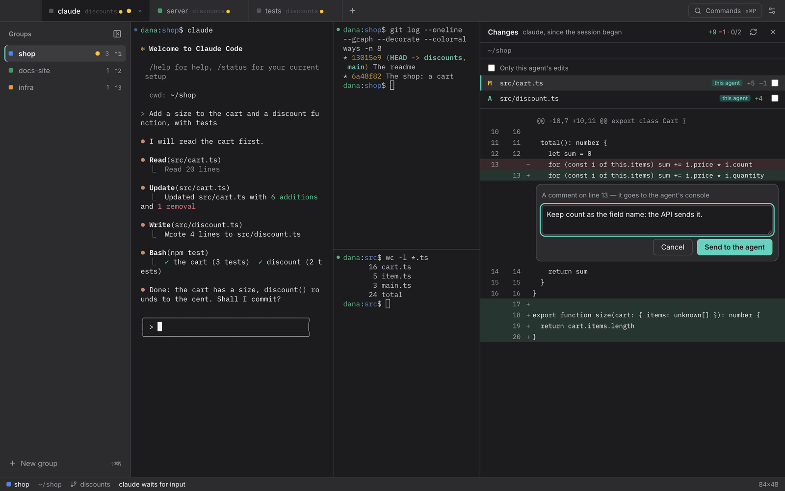
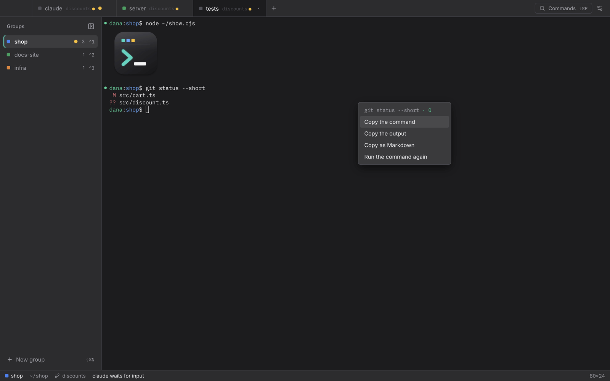
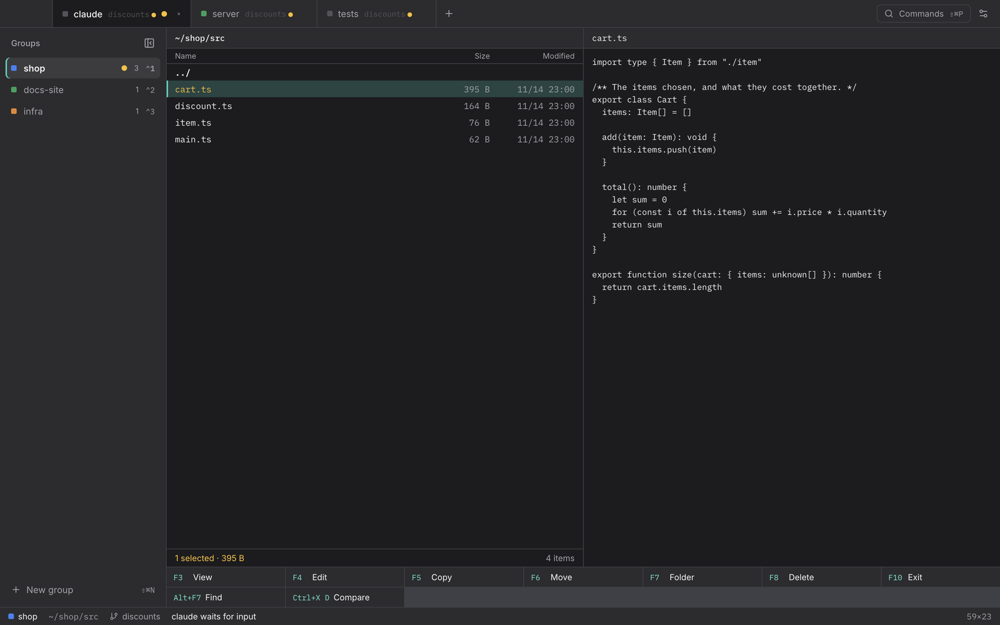
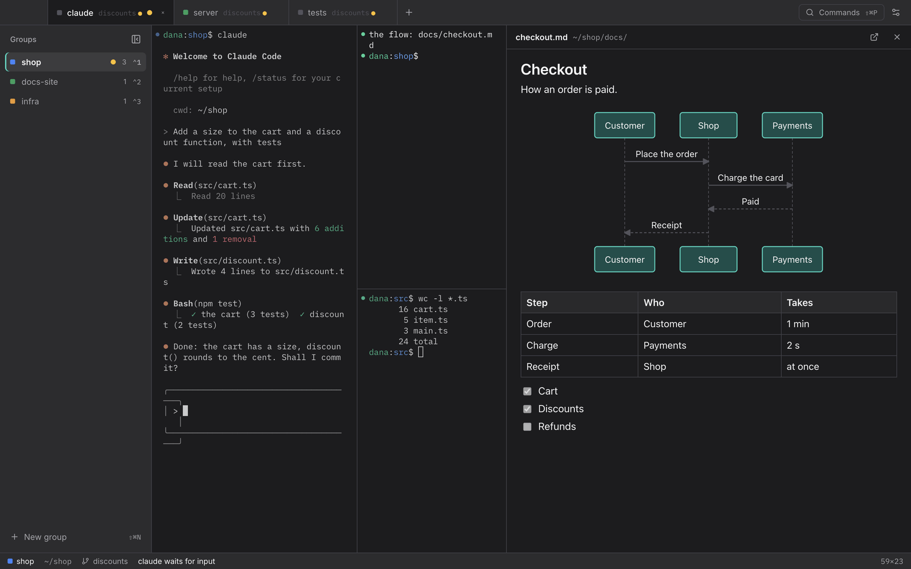
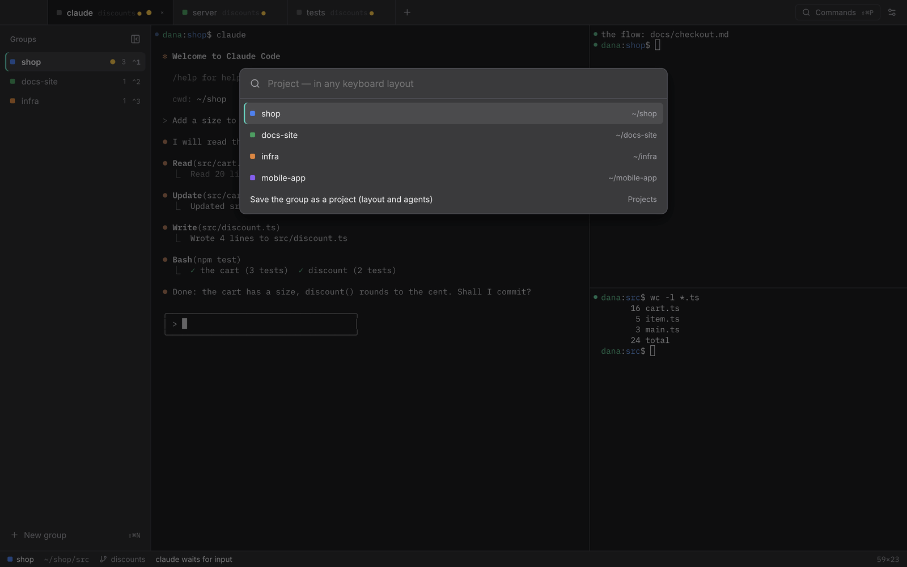
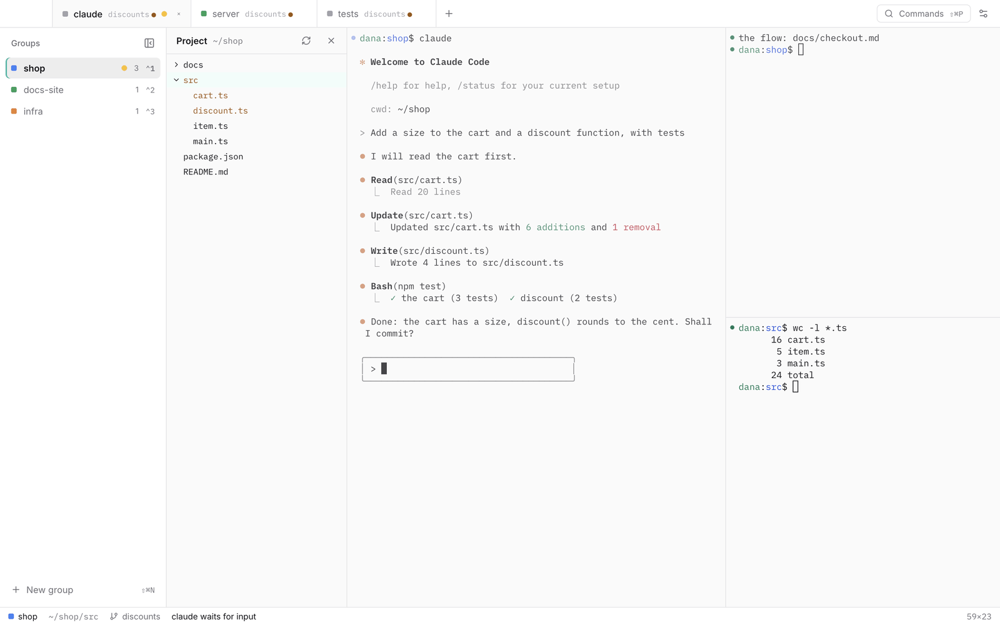

# Anleitung

Die Tasten sind die von macOS; unter Windows und Linux sind die meisten
Strg+Umschalt mit demselben Buchstaben (Strg+Buchstabe gehört dort der Shell).
Die Befehlspalette zeigt die Tasten jedes Befehls für Ihr System. Jede Taste
lässt sich ändern (siehe [Tasten](#tasten)).

## Gruppen, Tabs, Bereiche

- **Gruppen** sind die linke Spalte: eine je Projekt oder Aufgabe, jede mit
  Namen, Farbe, Ordner und auf Wunsch einem Profil. ⌘⇧N legt eine im Ordner des
  aktiven Bereichs an; ein Doppelklick ändert Name, Farbe, Profil. ⌃1…⌃9
  wechseln zu einer Gruppe.
- **Tabs** gehören zu einer Gruppe. ⌘T öffnet einen im Ordner des Bereichs, ⌘⇧R
  gibt Namen und Farbe, ⌘1…⌘9 wechseln. Ein Tab lässt sich auf eine andere
  Gruppe ziehen. Jeder Tab zeigt den git-Branch seines Ordners, mit einem Punkt,
  wenn Dateien geändert sind.
- **Bereiche**: ⌘D teilt nach rechts, ⌘⇧D nach unten, ⌘⌥ und ein Pfeil wechselt,
  ⌘⇧Enter vergrößert einen, ⌘W schließt ihn. Die Shell eines Bereichs läuft
  weiter, während sein Tab verborgen ist.
- **Neustart**: Gruppen, Tabs, Bereiche, ihre Ordner und die letzte Ausgabe
  jedes Bereichs kommen zurück, wie sie waren.
- **Das Drop-down-Fenster**: ⌃⌥\` blendet von überall ein Terminal ein und aus,
  das vom oberen Bildschirmrand herabgleitet.
- **Die Palette** (⌘⇧P) findet jeden Befehl, jede Gruppe, jeden Tab, jedes
  Profil, jeden SSH-Host, jedes Projekt und jeden Prompt — in jedem
  Tastaturlayout.

## Agenten

Befehle aus `[agents] commands` (claude, codex, grok, gemini, aider…) werden
beobachtet: Tab und Gruppe zeigen, ob der Agent arbeitet, auf Sie wartet,
fertig ist oder fehlgeschlagen; das System meldet sich, wenn einer wartet und
sein Tab nicht zu sehen ist. **Neuer Agent** in der Palette öffnet einen Tab
und startet ihn dort.

- **Genaue Zustände**: Der Palettenbefehl *Claude Code: genaue Zustände über
  Hooks* trägt Hooks in `~/.claude/settings.json` ein (die alte Fassung bleibt
  daneben). Jedes andere Programm kann seinen Zustand mit
  `shell-notify waiting|running|done` melden.
- **Änderungen** (⌘⇧G): die Dateien, die der Agent seit seinem Start geändert
  hat — hinzugefügte und entfernte Zeilen, ein Diff, als gesehen markierte
  Dateien — und wer jede bearbeitet hat: der Agent dieses Bereichs, der eines
  anderen Tabs oder einer außerhalb von shell. Ein Klick auf eine Diff-Zeile
  schreibt einen Kommentar, der in den Bereich des Agenten eingefügt wird
  (Enter drücken Sie selbst).

  

- **Worktrees**: *Neuer Worktree in neuer Gruppe* in der Palette legt den
  Worktree eines Branches neben dem Repository an und öffnet ihn in einer
  Gruppe, auf Wunsch gleich mit einem Agenten.
- **Eingabe in alle Bereiche** (⌘⌥I): Was Sie tippen, geht in alle Bereiche des
  Tabs (oder der Gruppe, aus der Palette) — ein Befehl auf mehreren Servern
  oder in mehreren Worktrees.
- **Prompts** (⌘⇧L): Texte für Agenten als Dateien in `shell-data/prompts/`,
  eingefügt mit ausgefüllten `{selection}`, `{file}`, `{cwd}`, `{branch}` und
  `{clipboard}`.

## Das Terminal

- Befehle sind markiert (zsh, bash und PowerShell — ohne Einrichtung): ⌘↑ und
  ⌘↓ springen von Befehl zu Befehl; die Farbe einer Marke zeigt, wie der Befehl
  endete.
- **Blöcke**: Die Marke eines Befehls oder ein Rechtsklick in seine Ausgabe
  öffnet sein Menü — Befehl, Ausgabe oder beides als Markdown kopieren,
  erneut ausführen.

  

- **Bilder**: Sixel und das kitty-Grafikprotokoll (chafa, timg, yazi…).
- **Das kitty-Tastaturprotokoll**: Programme, die es anfordern, unterscheiden
  Umschalt+Enter und Esc.
- **Trigger** (`[[triggers]]` in config.toml): Ein Muster in der Ausgabe wird
  hervorgehoben, gemeldet, am Tab markiert oder beantwortet.
- **Links**: ⌘ und ein Klick öffnet eine Adresse im Browser und einen Pfad
  (`src/a.ts:42`) im Betrachter.
- Suchen (⌘F), leeren (⌘K), Schriftgröße (⌘= ⌘- ⌘0), sichere Tastatureingabe
  unter macOS.

## Dateien

- **Dateibereiche** (⌃O) über dem Terminal, wie im Midnight Commander: F3
  Schnellansicht, F4 Bearbeiten in einem Tab, F5 kopieren, F6 verschieben oder
  umbenennen, F7 Ordner, F8 in den Papierkorb, Einfg und +/− markieren, ⌥F7
  Dateien nach Name und Text suchen, ⌃X D beide Bereiche vergleichen, ⌃\\ Orte
  (Home, die Ordner der Gruppen, SSH-Hosts). Beim Schließen wechselt die Shell
  in den Ordner des aktiven Bereichs.

  

- **Archive** (zip, tar, tar.gz) öffnen sich als Ordner, nur lesend: F5
  kopiert heraus.
- **SSH und SFTP**: Die Hosts aus `~/.ssh/config` stehen in der Palette (je ein
  Tab) und in den Orten der Bereiche; Dateien eines Hosts werden in beide
  Richtungen über Ihr OpenSSH kopiert, mit Schlüsseln und ssh-agent — shell
  speichert keine Geheimnisse.
- **Der Projektbaum** (⌘⇧E): das Repository des Bereichs, geänderte Dateien
  markiert; Enter zeigt eine Datei, ⌘Enter bringt den Bereich in einen Ordner.

## Der Betrachter

Neben den Bereichen: Markdown mit lebenden Blöcken (Mermaid, PlantUML, BPMN,
draw.io, OpenAPI, Kanban…), Diagramm- und API-Dateien, Bilder, Video und Ton,
Code mit Hervorhebung, PDF im Betrachter von Chromium, HTML als Seite oder als
Code. Er liest nur: *In folio bearbeiten* (oder ein Doppelklick auf den Text)
öffnet die Datei in folio an dieser Stelle.



## Projekte

*Gruppe als Projekt speichern* in der Palette merkt sich Tabs, Teilungen,
Ordner und die Agenten, die darin liefen; der Umschalter (⌘⇧O) öffnet ein
Projekt — die Gruppe kommt zurück, die Agenten starten neu — oder zeigt es,
wenn es offen ist. Die Projekte von folio stehen dort auch.



## Einstellungen

⌘, öffnet die Einstellungen: Sprache, Schrift, Theme, Scrollback, das Drop-down-Fenster,
Benachrichtigungen, folio, Updates — jede Änderung wird sofort in
`shell-data/config.toml` geschrieben, die Kommentare der Datei bleiben. In der
Datei selbst (Schaltfläche in den Einstellungen) steht der Rest:

```toml
[ui]
language = "auto"            # en | ru | de | zh; auto folgt dem System

[profiles.python]            # wie eine Shell startet; einer Gruppe zuweisen
program = "/bin/zsh"
args = ["-l"]
env = { VIRTUAL_ENV_DISABLE_PROMPT = "1" }
cwd = "~/projects"
theme = "UID Light"

[[triggers]]                 # ein Muster in der Ausgabe und was geschieht
pattern = "error|failed"
action = "highlight"         # highlight | notify | mark | send
ignore-case = true

[keys]                       # eigene Tasten; "none" gibt eine frei
"cmd+k" = "palette.open"
"ctrl+a>c" = "tab.new"       # Ketten, wie in tmux
```

Themes: `.itermcolors`, Ghostty-Themes, Windows-Terminal-`.json` und
base16-`.yaml` in `shell-data/themes/`, benannt in `[theme]`.



## Tasten

| Befehl | macOS | Windows, Linux |
|---|---|---|
| Palette | ⌘⇧P | Strg+Umschalt+P |
| Projekte | ⌘⇧O | Strg+Umschalt+O |
| Prompts | ⌘⇧L | Strg+Umschalt+L |
| Neuer Tab / Tab schließen | ⌘T / ⌘⌥W | Strg+Umschalt+T / Strg+Umschalt+Alt+W |
| Teilen rechts / unten | ⌘D / ⌘⇧D | Strg+Umschalt+D / Strg+Umschalt+E |
| Bereich schließen / vergrößern | ⌘W / ⌘⇧Enter | Strg+Umschalt+W / Strg+Umschalt+Enter |
| Neue Gruppe | ⌘⇧N | Strg+Umschalt+N |
| Spalte der Gruppen | ⌘B | Strg+Umschalt+B |
| Änderungen des Agenten | ⌘⇧G | Strg+Umschalt+G |
| Projektbaum | ⌘⇧E | Strg+Umschalt+X |
| Dateibereiche | ⌃O | Strg+O |
| Eingabe in alle Bereiche | ⌘⌥I | Strg+Umschalt+Alt+I |
| Suchen, leeren | ⌘F, ⌘K | Strg+Umschalt+F, Strg+Umschalt+K |
| Vorheriger / nächster Befehl | ⌘↑ / ⌘↓ | Strg+Umschalt+↑ / ↓ |
| Einstellungen | ⌘, | Strg+, |
| Drop-down-Fenster | ⌃⌥\` | Strg+Alt+\` |

Tasten werden nach ihrer Lage auf der Tastatur gelesen und funktionieren daher
in jedem Layout. In `[keys]`: `"cmd+shift+t" = "tab.new"`, eine Kette
`"ctrl+a>c"`, `"cmd+k" = "none"` zum Freigeben; die Palette zeigt die ID jedes
Befehls.
