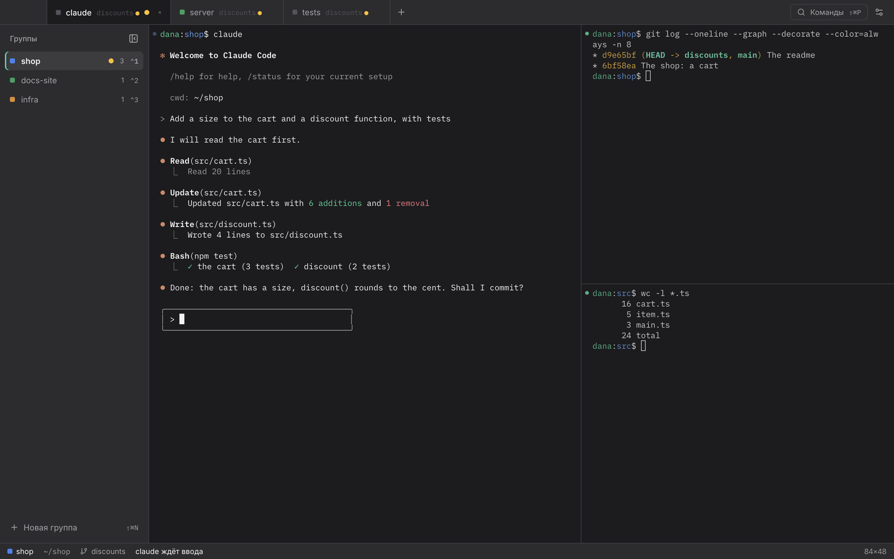

# shell

A terminal for macOS, Windows and Linux, made to replace the system one and to
work beside AI agents in the terminal — Claude Code, Codex, Grok and the like:
groups of tabs and split panes, agents shown working or waiting for you, their
changes with diffs, files the Midnight Commander way, documents with live
diagrams, SSH hosts. Portable and offline: no installer, no account, no
telemetry.

> Status: **0.7** — download the archive for your system from the [latest release](https://github.com/dskripchenko/shell/releases/latest).

- [Guide](guide.md) — what it does and how: groups, agents, files, the viewer,
  projects, settings, keys
- [Development](development.md) — building, running and testing it

## Beside the system

- No installer and no administrator rights: a zip on Windows and macOS, an
  AppImage on Linux.
- Settings, themes, the last session and prompts live in `shell-data/` beside
  the program; deleting the folder removes shell completely.
- Nothing goes to the network unless you ask: updates are looked for once a
  day (that can be turned off), SSH is your own OpenSSH.
- The terminal does not call any AI itself: agents are your command-line
  programs, shell watches and helps them through the pseudo-terminal, escape
  sequences and their own hooks.
- A document shown is not trusted: it sees only its own folder, never the
  window, and has no network.

## Beside folio

[folio](https://github.com/dskripchenko/folio) — the same author's app for
Markdown, code review and git — and shell find each other when both are on the
machine: a file opens in folio at its line, an agent's changes are reviewed
there, review comments go back to the agent's pane in shell, and both read one
journal of which agent edited what.
