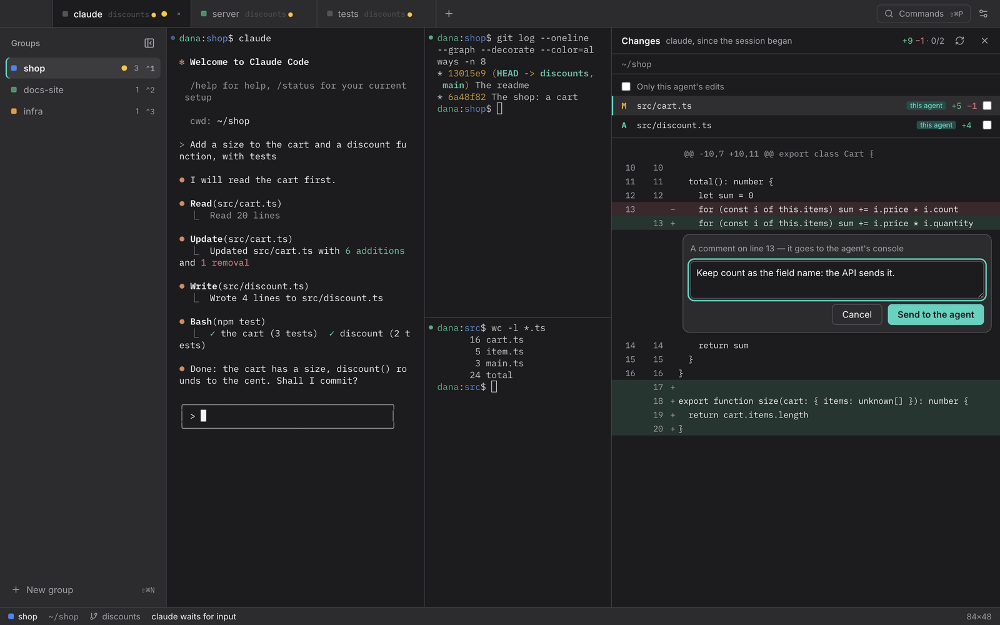
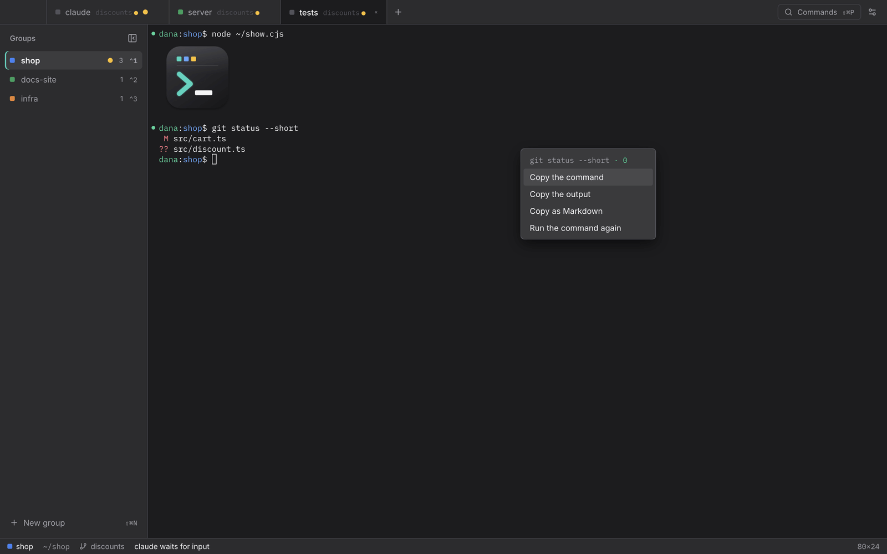
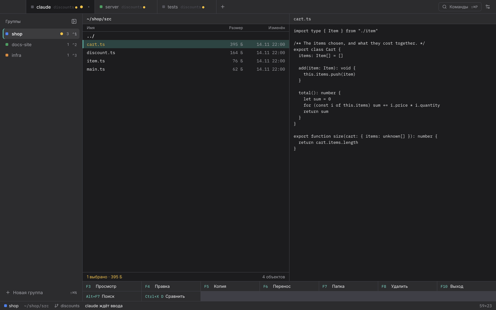
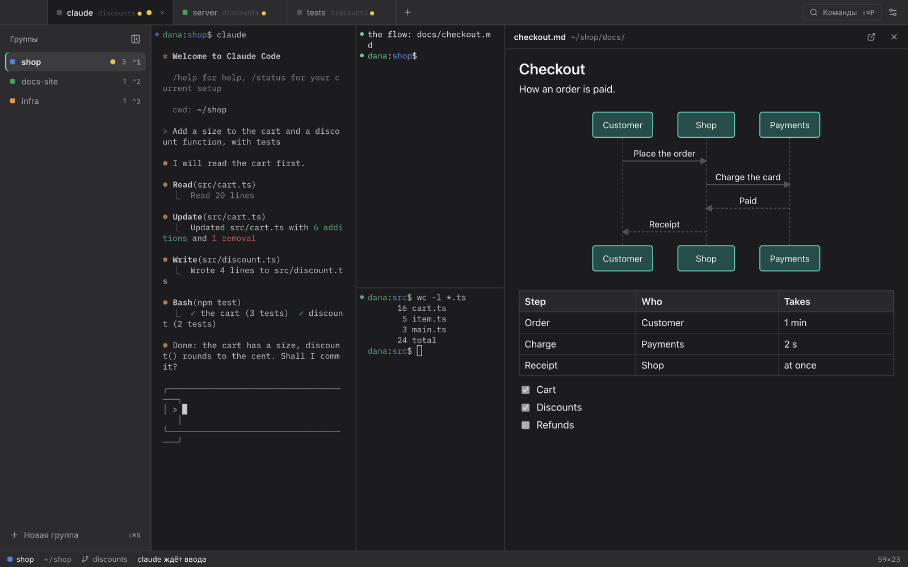
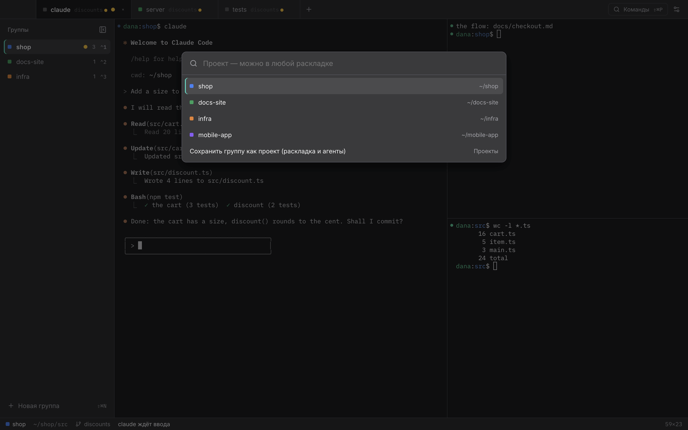
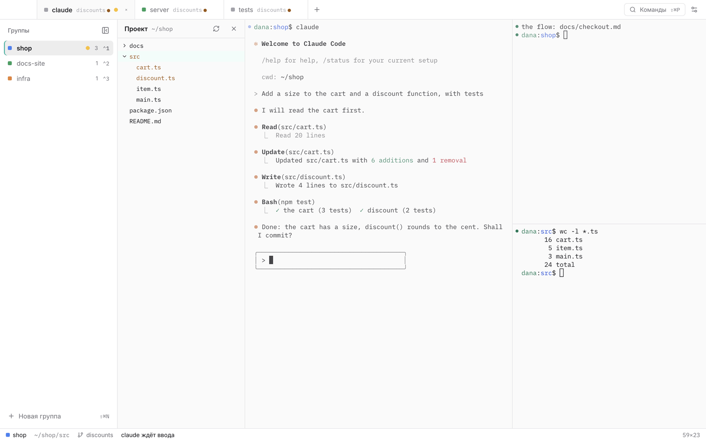

# Guide

The keys are macOS's; on Windows and Linux most are Ctrl+Shift with the same
letter (Ctrl+letter belongs to the shell there) — the palette shows each
command's keys on your system. Every key can be changed (see [Keys](#keys)).

## Groups, tabs, panes

- **Groups** are the left column: one per project or task, each with a name,
  a colour, its folder and, if you like, a profile. ⌘⇧N makes one in the
  focused pane's folder; a double click renames it, recolours it, gives it a
  profile. ⌃1…⌃9 go to a group.
- **Tabs** belong to a group. ⌘T opens one in the pane's folder, ⌘⇧R names
  and colours it, ⌘1…⌘9 go to one. A tab dragged onto another group moves
  there. Each tab shows its folder's git branch, with a dot when files are
  changed.
- **Panes**: ⌘D splits to the right, ⌘⇧D down, ⌘⌥ and an arrow moves between
  them, ⌘⇧Enter zooms one, ⌘W closes it. A pane's shell keeps running while
  its tab is hidden.
- **Restart**: groups, tabs, panes, their folders and each pane's last output
  come back as they were.
- **The drop-down window**: ⌃⌥\` anywhere shows and hides a terminal that slides
  from the top of the screen.
- **The palette** (⌘⇧P) finds any command, group, tab, profile, SSH host,
  project or prompt — on any keyboard layout.

## Agents

Commands listed in `[agents] commands` (claude, codex, grok, gemini, aider…)
are watched: their tab and group show whether the agent works, waits for you,
is done or failed; the system tells you when one waits and its tab is out of
sight. The palette's **New agent** opens a tab and starts one there.

- **Exact states**: the palette's *Claude Code: exact states through hooks*
  adds hooks to `~/.claude/settings.json` (its old copy kept beside it). Any
  other program can tell its state with `shell-notify waiting|running|done`.
- **Changes** (⌘⇧G): the files the agent changed since it started — added,
  removed lines, a diff, files marked as viewed — and who edited each: this
  pane's agent, another tab's, or one outside shell. A click on a diff line
  writes a comment that is pasted into the agent's pane (you press Enter).

  

- **Worktrees**: the palette's *New worktree in a new group* makes a branch's
  worktree beside the repository and opens it in a group, an agent started
  there if you choose.
- **Input to every pane** (⌘⌥I): what you type goes to all the panes of the
  tab (or of the group, from the palette) — one command on several servers or
  worktrees.
- **Prompts** (⌘⇧L): texts for agents kept as files in `shell-data/prompts/`,
  pasted into the pane with `{selection}`, `{file}`, `{cwd}`, `{branch}` and
  `{clipboard}` filled in.

## The terminal

- Commands are marked (zsh, bash and PowerShell — no setup): ⌘↑ and ⌘↓ go
  from command to command; a mark's colour says how the command ended.
- **Blocks**: a command's mark, or a right click in its output, opens its menu
  — copy the command, its output, both as Markdown, run it again.

  

- **Pictures**: sixel and the kitty graphics protocol (chafa, timg, yazi…).
- **The kitty keyboard protocol**: programs that ask for it get Shift+Enter
  and Esc of their own.
- **Triggers** (`[[triggers]]` in config.toml): a pattern in the output
  highlighted, said, marked on the tab, or answered.
- **Links**: ⌘ and a click opens an address in the browser and a path
  (`src/a.ts:42`) in the viewer.
- Find (⌘F), clear (⌘K), font size (⌘= ⌘- ⌘0), Secure Keyboard Entry on macOS.

## Files

- **File panels** (⌃O) over the terminal, as in Midnight Commander: F3 a quick
  view, F4 edit in a tab, F5 copy, F6 move or rename, F7 a folder, F8 to the
  trash, Insert and +/− to mark, ⌥F7 find files by name and text, ⌃X D compare
  the two panels, ⌃\\ places (home, the groups' folders, SSH hosts). Closing
  them takes the shell to the active panel's folder.

  

- **Archives** (zip, tar, tar.gz) open as folders, read only: F5 copies out.
- **SSH and SFTP**: the hosts of `~/.ssh/config` are in the palette (a tab
  each) and in the panels' places; a host's files are copied both ways over
  your OpenSSH, keys and ssh-agent — shell keeps no secrets.
- **The project's tree** (⌘⇧E): the pane's repository, changed files marked;
  Enter shows a file, ⌘Enter takes the pane to a folder.

## The viewer

Beside the panes: Markdown with live blocks (Mermaid, PlantUML, BPMN, draw.io,
OpenAPI, kanban…), diagram and API files, pictures, video and sound, code
highlighted, PDF in Chromium's viewer, HTML as a page or as code. It only
reads: *Edit in folio* (or a double click on the text) opens the file in folio
at that place.



## Projects

The palette's *Save group as project* keeps its tabs, splits, folders and the
agents that ran in them; the switcher (⌘⇧O) opens a project — its group back,
its agents started again — or shows it when it is open. folio's projects are
listed there too.



## Settings

⌘, opens the settings: language, font, theme, scrollback, the drop-down window,
notifications, folio, updates — each change written into
`shell-data/config.toml` at once, the file's comments kept. The file itself
(the button in the settings) holds the rest:

```toml
[ui]
language = "auto"            # en | ru | de | zh; auto follows the system

[profiles.python]            # how to start a shell; give it to a group
program = "/bin/zsh"
args = ["-l"]
env = { VIRTUAL_ENV_DISABLE_PROMPT = "1" }
cwd = "~/projects"
theme = "UID Light"

[[triggers]]                 # a pattern in the output, and what to do
pattern = "error|failed"
action = "highlight"         # highlight | notify | mark | send
ignore-case = true

[keys]                       # keys of your own; "none" takes one away
"cmd+k" = "palette.open"
"ctrl+a>c" = "tab.new"       # chains, as in tmux
```

**Updates** are in the settings' Updates section: the version, a *Check now*
button (or the palette's command), and a check once a day on its own. A new
version is downloaded and checked against the release's checksum; *Restart and
update* puts it in place at once, otherwise it goes in on quitting. An update
never touches `shell-data`.

Themes: `.itermcolors`, Ghostty themes, Windows Terminal `.json` and base16
`.yaml` in `shell-data/themes/`, named in `[theme]`.



## Keys

| Command | macOS | Windows, Linux |
|---|---|---|
| Palette | ⌘⇧P | Ctrl+Shift+P |
| Projects | ⌘⇧O | Ctrl+Shift+O |
| Prompts | ⌘⇧L | Ctrl+Shift+L |
| New tab / close the tab | ⌘T / ⌘⌥W | Ctrl+Shift+T / Ctrl+Shift+Alt+W |
| Split right / down | ⌘D / ⌘⇧D | Ctrl+Shift+D / Ctrl+Shift+E |
| Close the pane / zoom it | ⌘W / ⌘⇧Enter | Ctrl+Shift+W / Ctrl+Shift+Enter |
| New group | ⌘⇧N | Ctrl+Shift+N |
| Groups' column | ⌘B | Ctrl+Shift+B |
| Agent's changes | ⌘⇧G | Ctrl+Shift+G |
| Project's tree | ⌘⇧E | Ctrl+Shift+X |
| File panels | ⌃O | Ctrl+O |
| Input to every pane | ⌘⌥I | Ctrl+Shift+Alt+I |
| Find, clear | ⌘F, ⌘K | Ctrl+Shift+F, Ctrl+Shift+K |
| Previous / next command | ⌘↑ / ⌘↓ | Ctrl+Shift+↑ / ↓ |
| Settings | ⌘, | Ctrl+, |
| Drop-down window | ⌃⌥\` | Ctrl+Alt+\` |

Keys are read by their place on the keyboard, so they work on any layout. In
`[keys]`: `"cmd+shift+t" = "tab.new"`, a chain `"ctrl+a>c"`, `"cmd+k" = "none"`
to free one; the palette shows every command's id.
