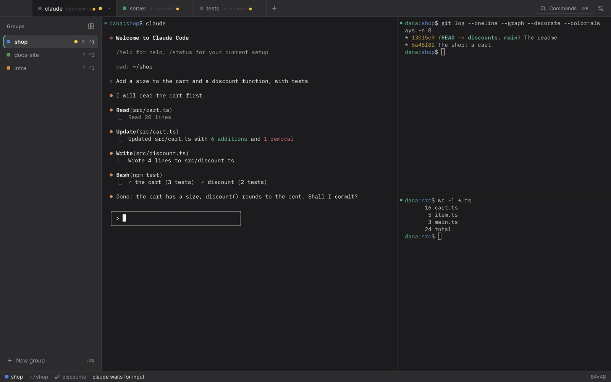

# shell

Терминал для macOS, Windows и Linux на замену системному — и для работы рядом
с ИИ-агентами в терминале: Claude Code, Codex, Grok и другими. Группы вкладок и
сплиты, агенты, которые видно — работают или ждут вас, — их изменения с diff,
файлы в духе Midnight Commander, документы с живыми схемами, SSH-хосты.
Портативный и без сети: без установщика, аккаунта и телеметрии.

> Статус: **0.9** — архив для вашей системы — в [последнем выпуске](https://github.com/dskripchenko/shell/releases/latest).

- [Руководство](guide.md) — что умеет и как: группы, агенты, файлы,
  просмотрщик, проекты, настройки, клавиши
- [Разработка](development.md) — сборка, запуск и тесты

## Рядом с системой

- Интерфейс на русском, английском, немецком или китайском — по умолчанию
  на языке системы.
- Без установщика и прав администратора: zip на Windows и macOS, AppImage на
  Linux.
- Настройки, темы, последний сеанс и промпты лежат в `shell-data/` рядом с
  программой; удалили папку — shell удалён полностью.
- В сеть — только по вашей воле: обновления проверяются раз в сутки (можно
  выключить), SSH — ваш собственный OpenSSH.
- Терминал сам не обращается ни к какому ИИ: агенты — ваши программы командной
  строки, shell следит за ними и помогает им через псевдотерминал,
  escape-последовательности и их собственные хуки.
- Показанному документу не доверяют: он видит только свою папку, не видит окно
  и не ходит в сеть.

## Рядом с folio

[folio](https://github.com/dskripchenko/folio) — приложение того же автора для
Markdown, ревью кода и git — и shell находят друг друга, когда оба есть на
компьютере: файл открывается в folio на нужной строке, изменения агента
ревьюятся там, замечания ревью возвращаются в панель агента в shell, а журнал
того, какой агент что правил, у обоих один.
