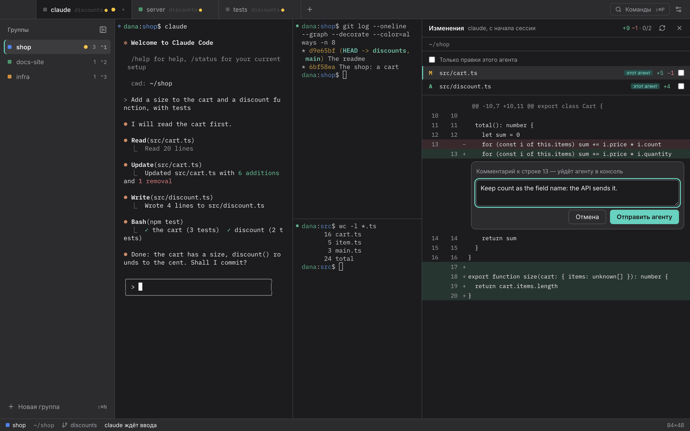
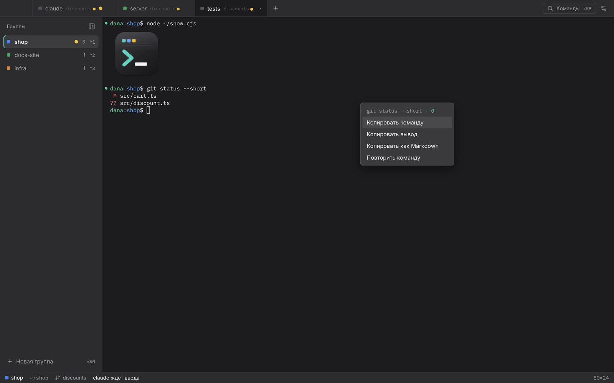
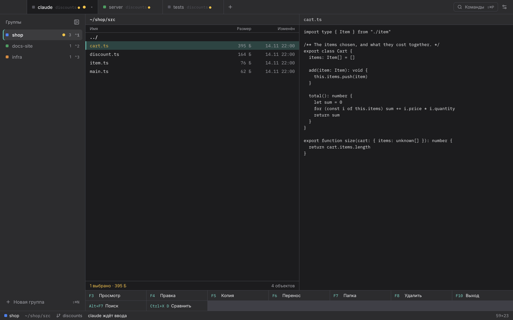
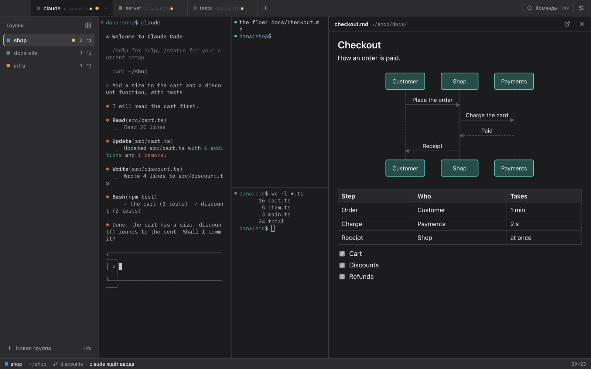
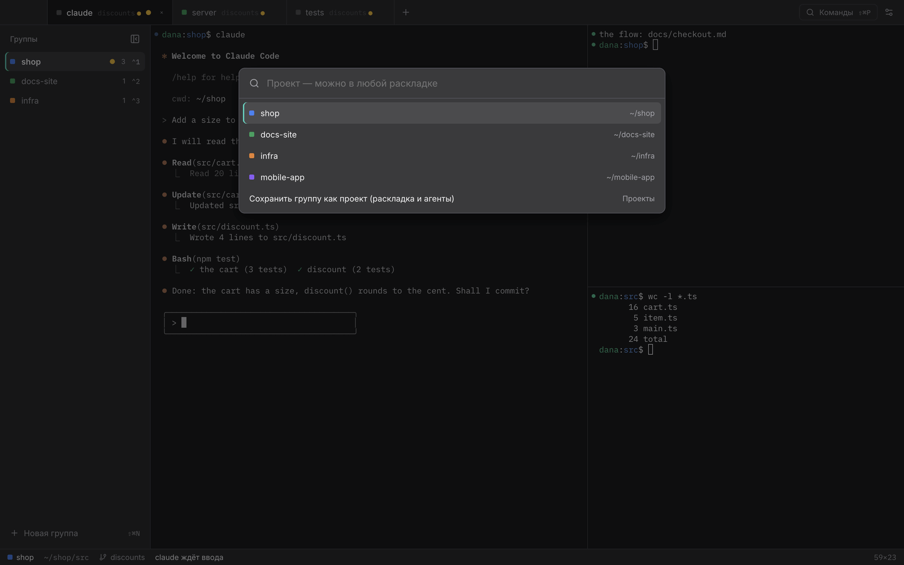
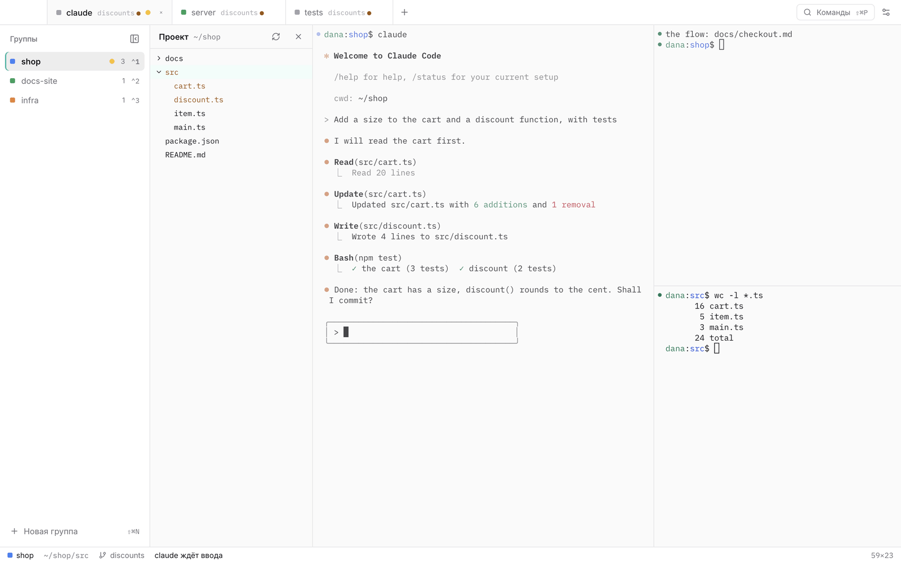

# Руководство

Клавиши указаны для macOS; на Windows и Linux большинство — Ctrl+Shift с той
же буквой (там Ctrl+буква принадлежит оболочке). Палитра показывает клавиши
каждой команды для вашей системы. Любую клавишу можно сменить (см.
[Клавиши](#клавиши)).

## Группы, вкладки, панели

- **Группы** — левая колонка: по одной на проект или задачу, у каждой имя,
  цвет, папка и, если нужно, профиль. ⌘⇧N создаёт группу в папке активной
  панели; двойной щелчок — имя, цвет, профиль. ⌃1…⌃9 — переход к группе.
- **Вкладки** принадлежат группе. ⌘T открывает вкладку в папке панели, ⌘⇧R —
  имя и цвет, ⌘1…⌘9 — переход. Вкладку можно перетащить на другую группу. На
  каждой вкладке — ветка git её папки и точка, если есть изменённые файлы.
- **Панели**: ⌘D делит вправо, ⌘⇧D вниз, ⌘⌥ со стрелкой — переход между
  панелями, ⌘⇧Enter разворачивает одну, ⌘W закрывает. Оболочка панели работает
  и тогда, когда её вкладка скрыта.
- **Перезапуск**: группы, вкладки, панели, их папки и последний вывод каждой
  панели возвращаются как были.
- **Выпадающее окно**: ⌃⌥\` откуда угодно показывает и прячет терминал, который
  выезжает сверху экрана.
- **Палитра** (⌘⇧P) находит любую команду, группу, вкладку, профиль, SSH-хост,
  проект или промпт — в любой раскладке.

## Агенты

Команды из `[agents] commands` (claude, codex, grok, gemini, aider…) под
присмотром: на вкладке и группе видно, работает агент, ждёт вас, закончил или
завершился с ошибкой; система сообщит, когда агент ждёт, а его вкладка не на
виду. **Новый агент** из палитры открывает вкладку и запускает его там.

- **Точные статусы**: команда палитры *Claude Code: точные статусы через хуки*
  добавляет хуки в `~/.claude/settings.json` (старая копия сохраняется рядом).
  Любая другая программа может сообщить своё состояние командой
  `shell-notify waiting|running|done`.
- **Изменения** (⌘⇧G): файлы, которые агент изменил с начала сессии, —
  добавленные и удалённые строки, diff, отметки «просмотрено» — и кто правил
  каждый: агент этой панели, другой вкладки или вне shell. Щелчок по строке
  diff — комментарий, который вставляется в панель агента (Enter нажимаете вы).

  

- **Worktree**: команда палитры *Новый worktree в новой группе* создаёт worktree
  ветки рядом с репозиторием и открывает его в группе, при желании сразу с
  агентом.
- **Ввод во все панели** (⌘⌥I): набранное уходит во все панели вкладки (или
  группы — из палитры): одна команда на нескольких серверах или в нескольких
  worktree.
- **Промпты** (⌘⇧L): тексты для агентов — файлы в `shell-data/prompts/`;
  вставляются в панель с подстановками `{selection}`, `{file}`, `{cwd}`,
  `{branch}` и `{clipboard}`.

## Терминал

- Команды размечены (zsh, bash и PowerShell — без настройки): ⌘↑ и ⌘↓ —
  переход от команды к команде; цвет метки говорит, как команда закончилась.
- **Блоки**: метка команды или правый щелчок по её выводу открывает меню —
  скопировать команду, вывод, всё вместе как Markdown, повторить.

  

- **Картинки**: sixel и протокол kitty graphics (chafa, timg, yazi…).
- **Протокол клавиатуры kitty**: программы, которые его просят, отличают
  Shift+Enter и Esc.
- **Триггеры** (`[[triggers]]` в config.toml): шаблон в выводе подсвечивается,
  о нём сообщается, вкладка отмечается — или на него отвечают.
- **Ссылки**: ⌘ и щелчок открывает адрес в браузере, а путь (`src/a.ts:42`) — в
  просмотрщике.
- Поиск (⌘F), очистка (⌘K), размер шрифта (⌘= ⌘- ⌘0), защищённый ввод на macOS.

## Файлы

- **Файловые панели** (⌃O) поверх терминала, как в Midnight Commander: F3
  быстрый просмотр, F4 правка во вкладке, F5 копия, F6 перенос или
  переименование, F7 папка, F8 в корзину, Insert и +/− — выделение, ⌥F7 поиск
  файлов по имени и тексту, ⌃X D сравнение панелей, ⌃\\ — места (домашняя
  папка, папки групп, SSH-хосты). При закрытии оболочка переходит в папку
  активной панели.

  

- **Архивы** (zip, tar, tar.gz) открываются как папки, только для чтения: F5
  копирует наружу.
- **SSH и SFTP**: хосты из `~/.ssh/config` — в палитре (по вкладке на хост) и в
  местах панелей; файлы хоста копируются в обе стороны через ваш OpenSSH,
  ключи и ssh-agent — shell секретов не хранит.
- **Дерево проекта** (⌘⇧E): репозиторий панели, изменённые файлы отмечены;
  Enter показывает файл, ⌘Enter переводит панель в папку.

## Просмотрщик

Рядом с панелями: Markdown с живыми блоками (Mermaid, PlantUML, BPMN, draw.io,
OpenAPI, канбан…), файлы схем и API, картинки, видео и звук, код с подсветкой,
PDF — во встроенном просмотрщике Chromium, HTML — как страница или как код.
Просмотрщик только читает: *Править в folio* (или двойной щелчок по тексту)
открывает файл в folio на этом месте.



## Проекты

Команда палитры *Сохранить группу как проект* запоминает вкладки, сплиты,
папки и агентов, которые в них работали; переключатель (⌘⇧O) открывает проект
— группа возвращается, агенты запускаются снова — или показывает его, если он
уже открыт. Там же — проекты folio.



## Настройки

⌘, открывает настройки: шрифт, тема, прокрутка, выпадающее окно, уведомления,
folio, обновления — каждое изменение сразу пишется в `shell-data/config.toml`,
комментарии файла сохраняются. В самом файле (кнопка в настройках) — остальное:

```toml
[profiles.python]            # как запускать оболочку; назначается группе
program = "/bin/zsh"
args = ["-l"]
env = { VIRTUAL_ENV_DISABLE_PROMPT = "1" }
cwd = "~/projects"
theme = "UID светлая"

[[triggers]]                 # шаблон в выводе и что делать
pattern = "error|failed"
action = "highlight"         # highlight | notify | mark | send
ignore-case = true

[keys]                       # свои клавиши; "none" снимает
"cmd+k" = "palette.open"
"ctrl+a>c" = "tab.new"       # цепочки, как в tmux
```

Темы: `.itermcolors`, темы Ghostty, `.json` Windows Terminal и `.yaml` base16 в
`shell-data/themes/`, имя — в `[theme]`.



## Клавиши

| Команда | macOS | Windows, Linux |
|---|---|---|
| Палитра | ⌘⇧P | Ctrl+Shift+P |
| Проекты | ⌘⇧O | Ctrl+Shift+O |
| Промпты | ⌘⇧L | Ctrl+Shift+L |
| Новая вкладка / закрыть вкладку | ⌘T / ⌘⌥W | Ctrl+Shift+T / Ctrl+Shift+Alt+W |
| Сплит вправо / вниз | ⌘D / ⌘⇧D | Ctrl+Shift+D / Ctrl+Shift+E |
| Закрыть панель / развернуть | ⌘W / ⌘⇧Enter | Ctrl+Shift+W / Ctrl+Shift+Enter |
| Новая группа | ⌘⇧N | Ctrl+Shift+N |
| Колонка групп | ⌘B | Ctrl+Shift+B |
| Изменения агента | ⌘⇧G | Ctrl+Shift+G |
| Дерево проекта | ⌘⇧E | Ctrl+Shift+X |
| Файловые панели | ⌃O | Ctrl+O |
| Ввод во все панели | ⌘⌥I | Ctrl+Shift+Alt+I |
| Поиск, очистка | ⌘F, ⌘K | Ctrl+Shift+F, Ctrl+Shift+K |
| Предыдущая / следующая команда | ⌘↑ / ⌘↓ | Ctrl+Shift+↑ / ↓ |
| Настройки | ⌘, | Ctrl+, |
| Выпадающее окно | ⌃⌥\` | Ctrl+Alt+\` |

Клавиши читаются по месту на клавиатуре, поэтому работают в любой раскладке. В
`[keys]`: `"cmd+shift+t" = "tab.new"`, цепочка `"ctrl+a>c"`, `"cmd+k" = "none"` —
освободить; палитра показывает id каждой команды.
