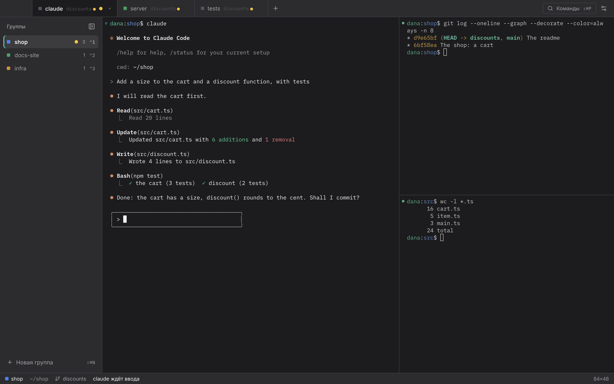

# shell

一款适用于 macOS、Windows 和 Linux 的终端，用来替代系统自带的终端，也用来在终端里与
AI 智能体（Claude Code、Codex、Grok 等）一起工作：标签分组与分屏，一眼看出智能体是在
工作还是在等你，查看它们的改动和 diff，Midnight Commander 风格的文件面板，带实时图表的
文档，SSH 主机。便携、离线：无需安装，无需账号，没有遥测。

> 状态：**0.7** —— 请从[最新版本](https://github.com/dskripchenko/shell/releases/latest)下载适合你系统的压缩包。

- [使用指南](guide.md) —— 能做什么、怎么做：分组、智能体、文件、查看器、项目、设置、快捷键
- [开发](development.md) —— 构建、运行与测试

## 与系统相处

- 无需安装程序和管理员权限：Windows 和 macOS 上是 zip，Linux 上是 AppImage。
- 设置、主题、上次的会话和提示词都在程序旁边的 `shell-data/` 中；删除该文件夹即可完全
  移除 shell。
- 只有在你需要时才联网：每天检查一次更新（可关闭），SSH 使用你自己的 OpenSSH。
- 终端本身不调用任何 AI：智能体就是你的命令行程序，shell 通过伪终端、转义序列和它们自己
  的钩子来观察和协助它们。
- 显示的文档不被信任：它只能看到自己的文件夹，看不到窗口，也不能联网。

## 与 folio 配合

[folio](https://github.com/dskripchenko/folio) 是同一作者的 Markdown、代码审查与 git
应用。两者都安装时会自动找到对方：文件在 folio 中按行打开，智能体的改动在那里审查，审查意见
回到 shell 中智能体所在的窗格，两者共用同一份“哪个智能体改了什么”的日志。
