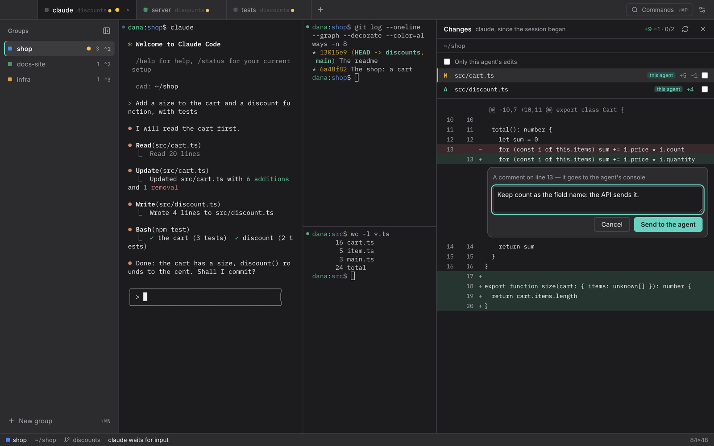
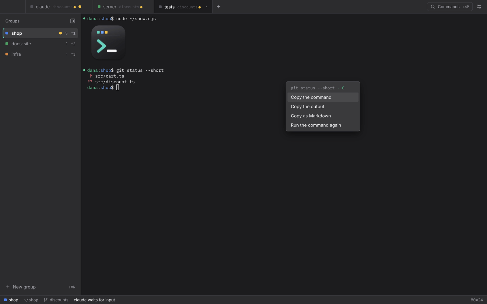
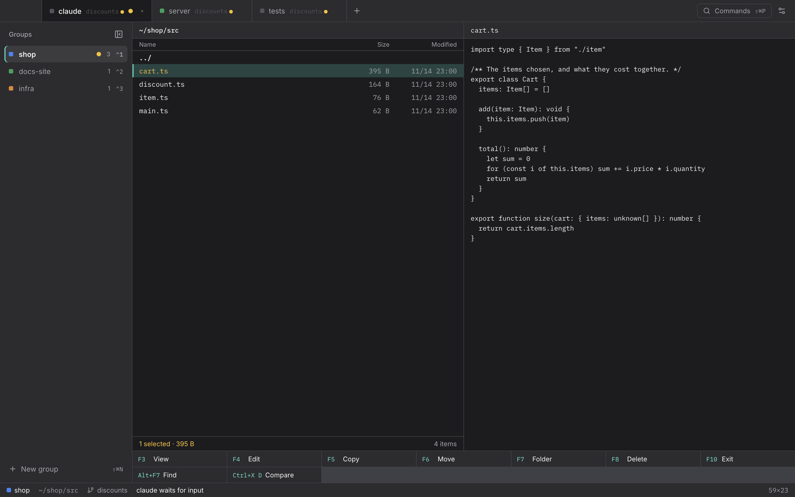
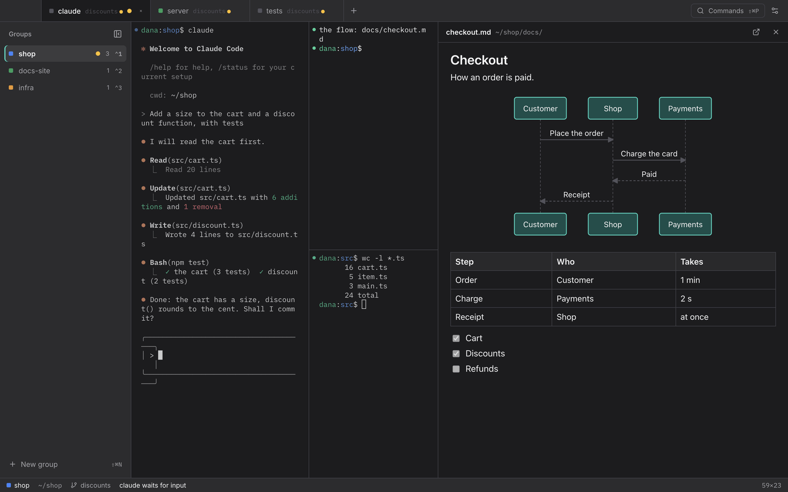
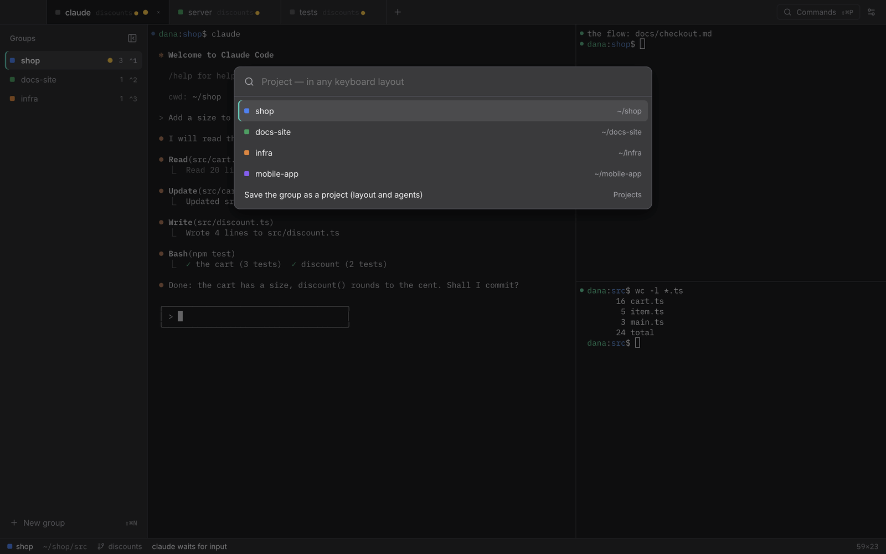
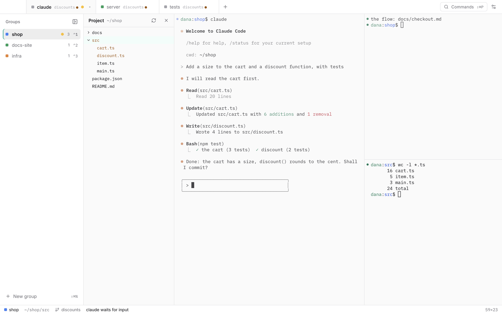

# 使用指南

文中快捷键以 macOS 为准；在 Windows 和 Linux 上，大多数是同一字母配 Ctrl+Shift（那里
Ctrl+字母属于 shell 程序本身）。命令面板会按你的系统显示每个命令的快捷键。所有快捷键都可以
修改（见[快捷键](#快捷键)）。

## 分组、标签、窗格

- **分组**在左侧一栏：每个项目或任务一个，各有名称、颜色、文件夹，也可以指定配置（profile）。
  ⌘⇧N 在当前窗格的文件夹中新建分组；双击可修改名称、颜色和配置。⌃1…⌃9 切换分组。
- **标签**属于分组。⌘T 在窗格的文件夹中打开新标签，⌘⇧R 设置名称和颜色，⌘1…⌘9 切换。
  标签可以拖到另一个分组。每个标签显示其文件夹的 git 分支，有改动的文件时带一个圆点。
- **窗格**：⌘D 向右分屏，⌘⇧D 向下，⌘⌥ 加方向键在窗格间移动，⌘⇧Enter 放大一个，⌘W
  关闭。标签隐藏时，其中的 shell 仍在运行。
- **重启后**：分组、标签、窗格、它们的文件夹以及每个窗格最后的输出都会恢复原样。
- **下拉窗口**：在任何地方按 ⌃⌥\` 显示或隐藏一个从屏幕顶部滑下的终端。
- **命令面板**（⌘⇧P）可以找到任何命令、分组、标签、配置、SSH 主机、项目或提示词——任何
  键盘布局下都可用。

## 智能体

`[agents] commands` 中列出的命令（claude、codex、grok、gemini、aider…）会被关注：标签和
分组上显示智能体是在工作、在等你、已完成还是出错；当智能体在等待而它的标签不在视线内时，系统会
通知你。命令面板中的 **新建智能体** 会打开一个标签并在其中启动它。

- **精确状态**：命令面板中的 *Claude Code：通过钩子获得精确状态* 会在
  `~/.claude/settings.json` 中添加钩子（旧文件的副本保存在旁边）。其他任何程序都可以用
  `shell-notify waiting|running|done` 报告状态。
- **改动**（⌘⇧G）：智能体启动以来改动的文件——增删的行数、diff、标记为已看——以及每个文件是
  谁改的：本窗格的智能体、另一个标签的智能体，还是 shell 之外的智能体。点击 diff 的某一行可写
  评论，评论会粘贴到智能体的窗格中（由你按 Enter 发送）。

  

- **Worktree**：命令面板中的 *在新分组中新建 worktree* 会在仓库旁为某个分支创建 worktree，
  并在一个分组中打开它，可选择同时启动智能体。
- **输入到所有窗格**（⌘⌥I）：你输入的内容会发送到该标签的所有窗格（或从命令面板选择整个分组）
  ——在多台服务器或多个 worktree 中执行同一条命令。
- **提示词**（⌘⇧L）：给智能体的文本，以文件形式保存在 `shell-data/prompts/` 中，粘贴到窗格时
  会填入 `{selection}`、`{file}`、`{cwd}`、`{branch}` 和 `{clipboard}`。

## 终端

- 命令会被标记（zsh、bash 和 PowerShell，无需配置）：⌘↑ 和 ⌘↓ 在命令之间跳转；标记的颜色表示
  命令如何结束。
- **块**：点击命令的标记，或在其输出上右键，打开菜单——复制命令、输出，或两者一起作为
  Markdown，重新运行。

  

- **图片**：sixel 和 kitty 图形协议（chafa、timg、yazi…）。
- **kitty 键盘协议**：请求它的程序可以区分 Shift+Enter 和 Esc。
- **触发器**（config.toml 中的 `[[triggers]]`）：输出中匹配的内容可被高亮、通知、在标签上标记，
  或自动回答。
- **链接**：⌘ 加点击，在浏览器中打开网址，在查看器中打开路径（`src/a.ts:42`）。
- 查找（⌘F）、清屏（⌘K）、字号（⌘= ⌘- ⌘0），macOS 上的安全键盘输入。

## 文件

- **文件面板**（⌃O）覆盖在终端上，与 Midnight Commander 相同：F3 快速查看，F4 在标签中编辑，
  F5 复制，F6 移动或重命名，F7 新建文件夹，F8 移到废纸篓，Insert 和 +/− 选择，⌥F7 按名称和
  内容查找文件，⌃X D 比较两个面板，⌃\\ 常用位置（主目录、各分组的文件夹、SSH 主机）。关闭时，
  shell 会进入当前面板的文件夹。

  

- **压缩包**（zip、tar、tar.gz）可以像文件夹一样打开，只读：F5 复制出来。
- **SSH 和 SFTP**：`~/.ssh/config` 中的主机出现在命令面板（每个主机一个标签）和面板的常用位置
  中；主机上的文件通过你的 OpenSSH、密钥和 ssh-agent 双向复制——shell 不保存任何密码。
- **项目树**（⌘⇧E）：窗格所在的仓库，改动的文件有标记；Enter 查看文件，⌘Enter 让窗格进入该
  文件夹。

## 查看器

位于窗格旁边：带实时块的 Markdown（Mermaid、PlantUML、BPMN、draw.io、OpenAPI、看板…）、
图表和 API 文件、图片、视频和音频、带高亮的代码、用 Chromium 查看器打开的 PDF、以页面或代码
形式显示的 HTML。查看器只读：*在 folio 中编辑*（或双击文本）会在 folio 中打开该文件的对应位置。



## 项目

命令面板中的 *将分组保存为项目* 会记住其中的标签、分屏、文件夹以及在其中运行的智能体；项目切换器
（⌘⇧O）打开项目——分组恢复，智能体重新启动——如果已经打开则直接切换过去。folio 的项目也列在
这里。



## 设置

⌘, 打开设置：界面语言、字体、主题、回滚行数、下拉窗口、通知、folio、更新——每项修改都会立即写入
`shell-data/config.toml`，并保留文件中的注释。其余内容在文件本身中（设置里有按钮打开）：

```toml
[ui]
language = "auto"            # en | ru | de | zh；auto 跟随系统

[profiles.python]            # 如何启动 shell；可指定给分组
program = "/bin/zsh"
args = ["-l"]
env = { VIRTUAL_ENV_DISABLE_PROMPT = "1" }
cwd = "~/projects"
theme = "UID Light"

[[triggers]]                 # 输出中的模式，以及要做什么
pattern = "error|failed"
action = "highlight"         # highlight | notify | mark | send
ignore-case = true

[keys]                       # 自定义快捷键；"none" 表示取消
"cmd+k" = "palette.open"
"ctrl+a>c" = "tab.new"       # 组合键序列，类似 tmux
```

主题：把 `.itermcolors`、Ghostty 主题、Windows Terminal 的 `.json` 和 base16 的 `.yaml`
放进 `shell-data/themes/`，并在 `[theme]` 中写上名称。



## 快捷键

| 命令 | macOS | Windows、Linux |
|---|---|---|
| 命令面板 | ⌘⇧P | Ctrl+Shift+P |
| 项目 | ⌘⇧O | Ctrl+Shift+O |
| 提示词 | ⌘⇧L | Ctrl+Shift+L |
| 新标签 / 关闭标签 | ⌘T / ⌘⌥W | Ctrl+Shift+T / Ctrl+Shift+Alt+W |
| 向右 / 向下分屏 | ⌘D / ⌘⇧D | Ctrl+Shift+D / Ctrl+Shift+E |
| 关闭窗格 / 放大 | ⌘W / ⌘⇧Enter | Ctrl+Shift+W / Ctrl+Shift+Enter |
| 新建分组 | ⌘⇧N | Ctrl+Shift+N |
| 分组栏 | ⌘B | Ctrl+Shift+B |
| 智能体的改动 | ⌘⇧G | Ctrl+Shift+G |
| 项目树 | ⌘⇧E | Ctrl+Shift+X |
| 文件面板 | ⌃O | Ctrl+O |
| 输入到所有窗格 | ⌘⌥I | Ctrl+Shift+Alt+I |
| 查找、清屏 | ⌘F、⌘K | Ctrl+Shift+F、Ctrl+Shift+K |
| 上一条 / 下一条命令 | ⌘↑ / ⌘↓ | Ctrl+Shift+↑ / ↓ |
| 设置 | ⌘, | Ctrl+, |
| 下拉窗口 | ⌃⌥\` | Ctrl+Alt+\` |

快捷键按键位读取，因此在任何键盘布局下都可用。在 `[keys]` 中：`"cmd+shift+t" = "tab.new"`，
组合序列 `"ctrl+a>c"`，`"cmd+k" = "none"` 表示取消；命令面板会显示每个命令的 id。
